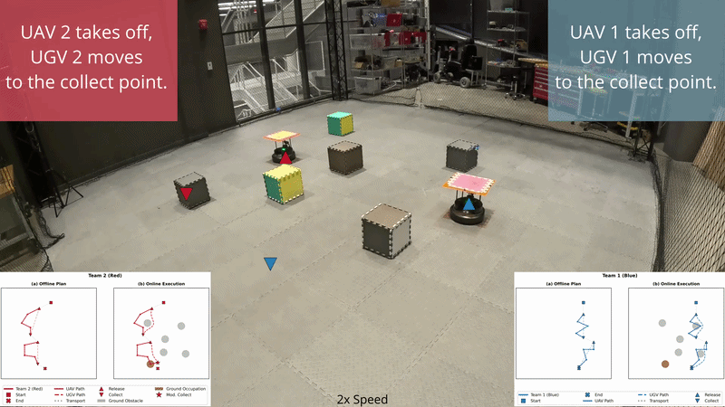
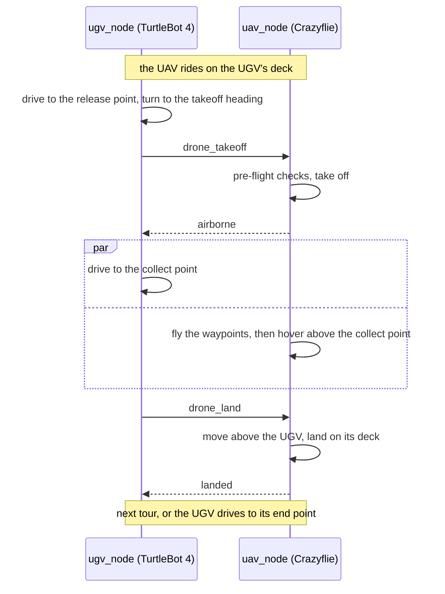

# Multi-UAV–UGV Planning with Crazyflies and TurtleBot 4

A minimal ROS 2 framework for running **planned missions with teams of UAVs and UGVs in a
motion-capture arena**. Each team is a [Crazyflie 2.1](https://www.bitcraze.io/products/crazyflie-2-1/) carried by
a [TurtleBot 4](https://turtlebot.github.io/turtlebot4-user-manual/). The UGV acts as a mobile
carrier (and charging station): it drives its UAV to a **release point**, the UAV takes off and
flies a **tour** of waypoints, and the UGV picks it up again at a **collect point**. OptiTrack
provides localization for every robot.



*Two teams in our arena during the RSPECT experiments (2× speed).*

This is the lab setup behind the experiments in
[RSPECT (Er, Kashiri, Yazıcıoğlu, JIRS 2026)](https://doi.org/10.1007/s10846-026-02426-5),
released as a starting point for other researchers. It is **not** the RSPECT planner and does not
reproduce the paper's experiments: it executes whatever plan you give it, so you can plug in your
own planner.

## What it does

- **Runs a plan from a file.** A mission YAML lists, for each team, a start point, an end point and
  a sequence of tours (release point → waypoints → collect point). Any planner can write it.
- **Coordinates each UAV with its UGV.** The UGV only drives off once its UAV is airborne. Whoever
  reaches the collect point first waits: the UGV parks, or the UAV hovers until the UGV arrives,
  then the UAV lands on the UGV's live MoCap position.
- **Checks a plan before you fly it.** `check_mission` estimates every tour's flight and drive time
  with the same timing model the robots execute, and flags tours that exceed the flight-time budget
  or leave the arena.
- **Fails safe.** The UAV refuses to take off with a low battery or a bad Kalman estimate, and
  lands where it is if MoCap drops out, if it stays airborne too long, on any error, or on Ctrl+C.
  The UGV stops if its MoCap pose or LiDAR goes stale.
- **Avoids obstacles on the ground.** The UGV runs a go-to-goal controller with an APF + vortex
  layer on its LiDAR and on the other UGVs' MoCap poses, plus an emergency stop.
- **Scales to any number of teams.** Add a team to the fleet and mission files.

## How a tour runs



Both services are `std_srvs/Trigger` and answer only once the action is done, so the UGV leads
the team and never moves while its UAV is on the deck taking off or landing.

## Requirements

| | Our setup |
|---|---|
| UAVs | Crazyflie 2.1, firmware 2026.04, one Crazyradio 2.0 per Crazyflie, a landing pad on the UGV |
| UGVs | TurtleBot 4 (standard), ROS 2 namespaces `/ugv1`, `/ugv2`, … |
| Localization | OptiTrack; one `geometry_msgs/PoseStamped` topic per rigid body, world frame z-up |
| Computer | Ubuntu 22.04, ROS 2 Humble, Python 3.10, cflib 0.1.32 |

All nodes run on one computer that reaches the TurtleBots over Wi-Fi and the Crazyflies over radio.

## Install

```bash
sudo apt install ros-humble-desktop python3-yaml
pip install cflib                       # Crazyflie Python library (not in rosdep)
# Crazyradio USB permissions: see docs/hardware_setup.md

mkdir -p ~/ros2_ws/src && cd ~/ros2_ws/src
git clone https://github.com/cahiter/multi-uav-ugv-planning.git
cd ~/ros2_ws && colcon build --packages-select uav_ugv_nav
source install/setup.bash
```

You also need a MoCap driver that publishes a `PoseStamped` per rigid body; see
[docs/hardware_setup.md](docs/hardware_setup.md).

## Quick start

1. **Describe your lab** in [`config/fleet.yaml`](uav_ugv_nav/config/fleet.yaml): the arena's safe
   box, and for each team the Crazyflie's radio URI and the MoCap topics of both robots.
2. **Write a mission** (or adapt [`missions/demo_two_teams.yaml`](uav_ugv_nav/missions/demo_two_teams.yaml))
   and check it:
   ```bash
   ros2 run uav_ugv_nav check_mission my_mission.yaml --fleet my_fleet.yaml
   ```
3. **Bring the hardware up step by step**: MoCap, LiDAR, Crazyflies on the ground, each UGV and
   each UAV alone. Follow [docs/bringup.md](docs/bringup.md).
4. **Run the mission**:
   ```bash
   ros2 launch uav_ugv_nav mission.launch.py mission:=my_mission.yaml fleet:=my_fleet.yaml
   ```
   Press Ctrl+C at any time: flying UAVs land where they are and the UGVs stop.

Useful launch arguments: `teams:=team1` (start only some teams), `robots:=ugv` or `robots:=uav`
(only one kind of robot), `standalone:=true` (UGVs drive / UAVs fly their tours without their
partner), `params:=my_params.yaml` (tuning).

## What you get in the logs

After every tour each robot reports what actually happened, next to the plan's budget:

```
[cf2.uav_node]: tour 2/2 done: flight 32.9 s (model 31.3 s), air slack 57.1 s (ok, min 20 s); hovered 1.4 s waiting for the UGV
[ugv2.ugv_node]: tour 2/2: done. Release->collect drive 23.8 s, ground slack 66.2 s (min 20 s); waited 6.1 s at collect
```

The slack values show how much of the flight-time budget each tour really left unused once
disturbances played out, such as an obstacle that made the UGV detour on its way to the collect
point.

## Repository layout

```
uav_ugv_nav/                     ROS 2 package (ament_python)
├── config/fleet.yaml            robots of each team, radio URIs, MoCap topics, arena box
├── config/params.yaml           tuning of the nodes (heights, speeds, APF gains, timeouts)
├── missions/demo_two_teams.yaml example plan: 2 teams, 5 tours
├── launch/mission.launch.py     starts the nodes of every team
├── uav_ugv_nav/
│   ├── mission.py, fleet.py     file formats, validation, timing model
│   ├── check_mission.py         plan checker (no ROS needed)
│   ├── uav/uav_node.py          Crazyflie mission executor (one per UAV)
│   ├── uav/crazyflie.py         the cflib calls used, and the pre-flight Kalman check
│   ├── uav/cf_check.py          ground test: radio, Kalman filter, MoCap
│   ├── ugv/ugv_node.py          TurtleBot 4 mission executor (one per UGV)
│   ├── ugv/apf.py               APF + vortex avoidance and emergency stop
│   └── ugv/scan_check.py        verifies the LiDAR mounting angle
└── test/                        unit tests and ament linters (colcon test)
docs/                            hardware setup, bring-up, mission format, troubleshooting
```

## Documentation

- [Hardware setup](docs/hardware_setup.md): OptiTrack, TurtleBot 4 networking, Crazyflie radios, the landing deck
- [Bring-up checklist](docs/bringup.md): from power-on to a full mission, one step at a time
- [Mission format](docs/mission_format.md): the YAML files, the timing model, connecting a planner
- [Troubleshooting](docs/troubleshooting.md): symptoms and fixes we ran into

## Citation

If this framework helps your research, please cite:

```bibtex
@article{er2026rspect,
  author  = {Er, Cahit Ikbal and Kashiri, Amin and Yaz{\i}c{\i}o{\u{g}}lu, Yasin},
  title   = {{RSPECT}: Robust and Scalable Planner for Energy-Aware Coordination of {UAV-UGV}
             Teams in Aerial Monitoring},
  journal = {Journal of Intelligent \& Robotic Systems},
  volume  = {112},
  pages   = {91},
  year    = {2026},
  doi     = {10.1007/s10846-026-02426-5}
}
```

A video of the paper's experiment: https://youtu.be/jQkGfwVTdBc

## Authors

Developed at Northeastern University by Cahit Ikbal Er (maintainer), extending the first
single-team version (one UAV, one UGV) developed with Amin Kashiri, under the supervision of
Yasin Yazıcıoğlu.

## License

[MIT](LICENSE)
