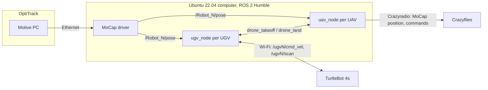

# Hardware setup

What the framework expects from each piece of hardware, and how we set ours up.
Lab-specific values (names, radio URIs, MoCap topics, the arena box) go in
[`config/fleet.yaml`](../uav_ugv_nav/config/fleet.yaml); tuning goes in
[`config/params.yaml`](../uav_ugv_nav/config/params.yaml).



All nodes run on one computer. Each `uav_node` owns one Crazyradio; each `ugv_node` drives
one TurtleBot 4 through its namespaced topics.

## Motion capture

The framework needs one `geometry_msgs/PoseStamped` topic per robot, in a common world frame
with **z up**, in meters.

- **One rigid body per robot.** Ours: `Robot_1` = ugv1, `Robot_2` = ugv2, `Robot_3` = cf1,
  `Robot_4` = cf2.
- **Stream z-up.** In Motive's streaming settings set *Up Axis* to *Z*. With y-up the UAVs
  would read their height in the wrong axis.
- **Put each UGV's pivot point at the center of its landing deck.** The UAV lands on the UGV's
  MoCap position, so an offset pivot means an off-center landing.
- **Don't publish untracked bodies.** The failsafes rely on poses *stopping* when tracking is
  lost. A driver that keeps repeating the last pose hides an occlusion.

We use [`mocap_optitrack`](https://github.com/ros-drivers/mocap_optitrack) on its ROS 2 branch,
`foxy-devel`, built from source on Humble. Its `config/mocap.yaml` maps Motive's rigid-body IDs to
topics and says where Motive streams to:

```yaml
mocap_node:
  ros__parameters:
    rigid_bodies:
      1:                        # ugv1; then 2 = ugv2, 3 = cf1, 4 = cf2
        pose: "Robot_1/pose"
        pose2d: "Robot_1/ground_pose"
        odom: Robot_1/Odom
        tf: tf
        child_frame_id: "Robot_1/base_link"
        parent_frame_id: "world"
    optitrack_config:
      multicast_address: "<multicast address set in Motive>"
      command_port: 1510
      data_port: 1511
      enable_optitrack: true
```

Its launch file reads the installed copy of this file, so rebuild the driver after editing it
(unless you built it with `--symlink-install`), then start it with
`ros2 launch mocap_optitrack mocap.launch.py`. Any other driver works if it publishes one
`PoseStamped` per rigid body, e.g. `vrpn_mocap`.

## TurtleBot 4

- **Namespaces.** Give each robot its own namespace (`ugv1`, `ugv2`, …) in `turtlebot4-setup`
  → *ROS Setup*. `ugv_node` runs in that namespace and drives `/<ns>/cmd_vel` from `/<ns>/scan`.
- **Discovery server.** Our TurtleBots run Fast DDS discovery servers. On the computer, list
  them **in the order of their server IDs** (the position in the list is the ID) and run as a
  super client:

  ```bash
  # /etc/turtlebot4_discovery/setup.bash, sourced from ~/.bashrc
  # Position in the list = server ID; here ugv2 runs server 0 and ugv1 runs server 1.
  export ROS_DISCOVERY_SERVER="<ugv2 IP>:11811;<ugv1 IP>:11811"
  export ROS_SUPER_CLIENT=True
  ```

  Restart the ROS 2 daemon after any change (`ros2 daemon stop; ros2 daemon start`), then check
  that `ros2 topic list` shows `/ugv1/scan` and `/ugv1/cmd_vel`. If the export is missing,
  nothing is discovered.
- **Undock** the robots before a mission.
- **LiDAR mounting.** On the TurtleBot 4 (standard and lite) the scan frame `rplidar_link` is
  yawed +90° from `base_link`, so `lidar_yaw_offset_deg: 90.0`. Check it with `scan_check`
  ([bring-up](bringup.md) step 3). With the wrong offset the emergency stop watches the robot's
  side instead of its front.
- **Landing deck.** A flat pad on the top plate. `deck_height` in `params.yaml` is the
  Crazyflie's MoCap z while it sits on the pad (0.39 m on ours). Measure it: put the Crazyflie
  on the deck and run `ros2 topic echo --once /Robot_3/pose`.

## Crazyflie

- **Firmware.** We used 2026.04 with cflib 0.1.32. See [troubleshooting](troubleshooting.md)
  for the quirks we hit with this version.
- **One Crazyradio per Crazyflie, each on its own channel and address.** Two Crazyflies on the
  same channel with two Crazyradios collide. Set the channel and address in `cfclient`
  (*Connect* → *Configure 2.x*). Ours:

  | UAV | URI | Crazyradio | Channel | Address |
  |---|---|---|---|---|
  | cf1 | `radio://0/80/2M/E7E7E7E7E7` | 0 | 80 | E7E7E7E7E7 (default) |
  | cf2 | `radio://1/100/2M/E7E7E7E7E8` | 1 | 100 | E7E7E7E7E8 |

  The first number of the URI is the Crazyradio's index in USB enumeration order. Check that
  both are plugged in with `lsusb | grep -i bitcraze`.
- **USB permissions.** Follow Bitcraze's
  [USB permissions guide](https://www.bitcraze.io/documentation/repository/crazyflie-lib-python/master/installation/usb_permissions/)
  so the radios work without root.
- **Heading.** Only the MoCap *position* is streamed to the Crazyflie, so its Kalman filter does
  not get yaw from MoCap and assumes the Crazyflie starts facing world **+x**. Mount it on the
  deck facing the UGV's front: the UGV turns to heading 0° (world +x) before every takeoff and
  landing (`align_yaw_deg` in `params.yaml`).
- **Power-cycle the Crazyflies between runs.**

## Computer

Ubuntu 22.04 with ROS 2 Humble (`ros-humble-desktop`) and `pip install cflib`. All nodes and
the MoCap driver run here. The computer needs Ethernet to the Motive PC, Wi-Fi to the
TurtleBots and one USB port per Crazyradio.
